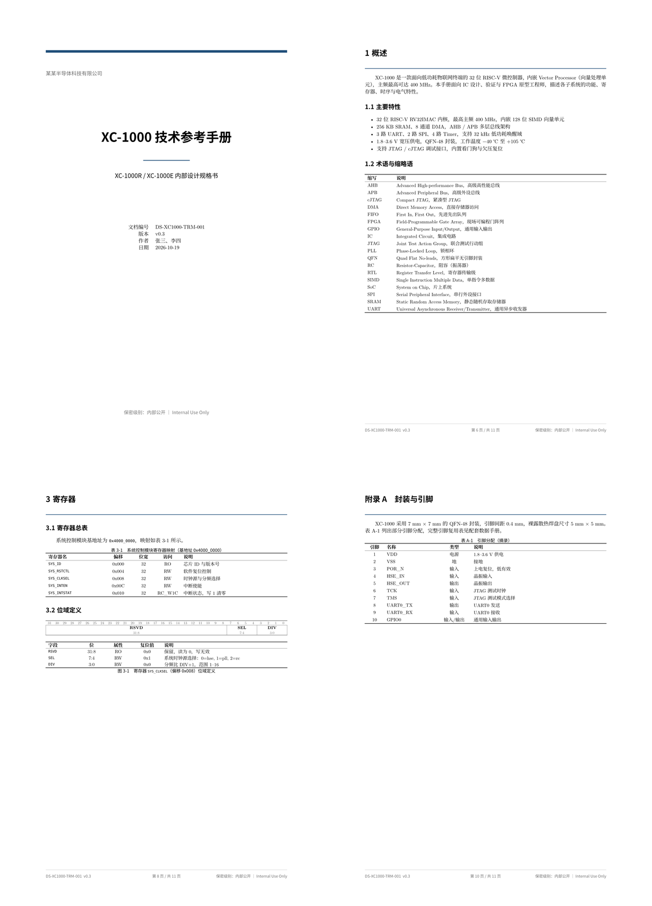
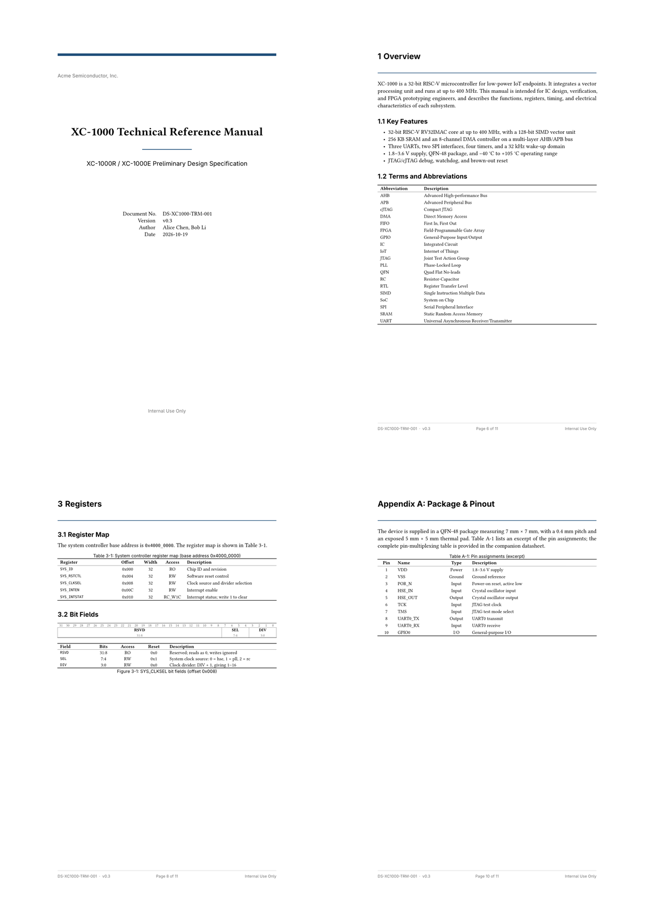

# Typst 芯片 TRM / 设计规格模板（中文 / English）

用于芯片技术参考手册（TRM）和设计规格书的 Typst 模板，含中文、英文两套独立排版：

- **中文版**：`template.typ` + `main.typ` → `main.pdf`（11 页）
- **英文版**：`template-en.typ` + `main-en.typ` → `main-en.pdf`（11 页）

两版共享同一套文档结构、组件和芯片手册惯例，但字体、行宽、断词、题注与参考文献格式分别按中英文排版规则处理。





## 文件

| 文件 | 说明 |
|---|---|
| `template.typ` | 中文模板：版式、封面、页脚、表格、位域图、寄存器表、参数表 |
| `main.typ` | 中文示例：XC-1000 完整文档骨架（11 页） |
| `main.pdf` | 中文示例编译结果 |
| `template-en.typ` | English template: layout, cover, footer, tables, bit fields, register map |
| `main-en.typ` | English sample (11 pages) |
| `main-en.pdf` | English sample output |
| `README-en.md` | English documentation |
| `preview/` | README 预览图 |

## 快速开始

```bash
typst compile main.typ        # 中文版 → main.pdf
typst compile main-en.typ     # 英文版 → main-en.pdf

typst watch main.typ          # 边写边编译
```

要求 Typst **0.15+**，可直接在 [Typst Web App](https://typst.app) 上传对应 `.typ` 文件使用。

## 业界惯例对齐

两版都按芯片 TRM 的常见做法组织：

- **按章编号**：`图 2-1` / `Figure 2-1`、`表 3-1` / `Table 3-1`、`式（4-1）` / `Equation (4-1)`；每章重置，附录表为 `表 A-1` / `Table A-1`
- **位域表含位**：`字段 / 位 / 属性 / 复位值 / 说明`，`Field / Bits / Access / Reset / Description`
- **三线表**：booktabs 风格，表内字号小于正文，单元格内关闭英文断词与两端对齐
- **题注归属**：表题在上、图题在下；题注贴近图表、远离上下文
- **参考文献独立**：不放在附录内，使用 IEEE 方括号编号、左对齐、悬挂缩进
- **附录**：`附录 A　封装与引脚` / `Appendix A: Package & Pinout`，含引脚表 `表 A-1`
- **缩略语表**：覆盖正文实际使用的缩写
- **PDF 元数据**：标题、作者写入 PDF

## 排版要点

### 中文版

| 项 | 设置 |
|---|---|
| 正文 | Noto Serif CJK SC，10 pt，0.64 em 行距 |
| 标题 | Noto Sans CJK SC Bold |
| 版心 | A4，上下 2.5 / 2.2 cm，左右 2.2 cm（每行约 47 字） |
| 段落 | 两端对齐，首行缩进 2 em，CJK–Latin 间距自动 |
| 表格 | 9 pt，booktabs 三线表 |
| 题注 | 8.5 pt 黑体；表题在上、图题在下 |
| 公式 | 按章编号，显示 `（4-1）`，正文引用 `式（4-1）` |
| 页脚 | 文档编号 · 版本 / 第 X 页 / 共 Y 页 / 保密级别 |

### 英文版

| 项 | 设置 |
|---|---|
| 正文 | Libertinus Serif，11 pt，0.63 em 行距 |
| 标题 / 题注 | Adwaita Sans Bold（回退 Liberation Sans） |
| 版心 | A4，上下 2.7 / 2.4 cm，左右 3.0 cm（每行约 94 字符） |
| 段落 | 两端对齐 + en-US 断词，首行缩进 1.4 em，标题后首段不缩进 |
| 表格 | 9 pt，booktabs 三线表，单元格内不做断词/两端对齐 |
| 题注 | `Figure 2-1: …` / `Table 3-1: …`，8.5 pt 无衬线 |
| 公式 | 按章编号，显示 `(4-1)`，正文引用 `Equation (4-1)` |
| 参考文献 | IEEE 风格 `[1]`，左对齐、悬挂缩进、不断词 |

### 为什么是这个页边距

页边距由目标**行宽**反推，而不是固定值：

- 中文 10 pt 在 A4 上左右 2.2 cm，每行约 47 字，接近中文技术手册上限；
- 英文 11 pt 若用 Word 默认 2.5 cm，会达到约 100 字符/行；把左右收到 3.0 cm，行宽约 94 字符；这已经是 11 pt 技术文档的上限，再窄会明显影响阅读。

表格和代码块会占用较多横向空间，因此没有继续加大边距。

## 文档结构

```text
封面 → 修订记录 → 目录 → 图目录 → 表目录
→ 1 概述（主要特性、术语与缩略语）
→ 2 系统架构（框图、时钟与复位、设计约束）
→ 3 寄存器（总表、位域定义）
→ 4 功能描述（UART 模块、固件示例）
→ 附录 A（封装与引脚，含引脚表）
→ 参考文献
```

## 配置

中文版编辑 `main.typ` 顶部 `conf`，英文版编辑 `main-en.typ` 的 `conf`；默认值在各自的 `trm-conf-default`：

| 键 | 中文版 | 英文版 | 说明 |
|---|---|---|---|
| `font-size` | 10 pt | 11 pt | 正文 |
| `table-size` | 9 pt | 9 pt | 表内文字 |
| `caption-size` | 8.5 pt | 8.5 pt | 图/表题注 |
| `code-size` | 8 pt | 8 pt | 代码块 |
| `margin` | 2.5 / 2.2 / 2.2 cm | 2.7 / 2.4 / 3.0 cm | 上 / 下 / 左右 |
| `heading-1-breaks` | `true` | `true` | 每章另起一页 |
| `numbering-pattern` | `1.1` | `1.1` | 章节编号 |

主色可在 `template.typ` / `template-en.typ` 顶部的 `accent-color` 修改。

## 常用组件

```typ
#sig("hclk")          // 行内信号名（等宽）
#reg("SYS_CLKSEL")    // 寄存器名

#fm-title([目录])     // 前置页标题（不进目录）

#rev-section(
  ("v0.1", "2026-08-01", "张三", "初稿"),
)

// 任意三线表
#booktabs(
  columns: (18%, 22%, 1fr),
  header: ([复位源], [影响范围], [行为描述]),
  rows: (([#sig("por_rstn")], [全芯片], [上电复位]),),
)

// 寄存器映射表（包 figure 参与编号）
#figure(caption: [...], kind: table, supplement: [表])[
  #reg-table(("SYS_ID", "0x000", 32, "RO", [芯片 ID]),)
] <tbl:regmap>

// 位域图 + 字段表（自动包含“位”列）
#bitfield(
  [寄存器 SYS_CLKSEL 位域],
  (("SEL", 7, 4, "RW", "0x1", [时钟源选择]),),
)

// 时序 / 电气参数表
#spec-table(([$f_"baud"$], [波特率], [—], [—], [6], [Mbps], [说明]),)

// 缩略语表
#acronyms(("AHB", "Advanced High-performance Bus，高级高性能总线"),)
```

英文版组件 API 相同，参数内容换成英文即可。

## 注意事项

- **中文段落不要手动折行**：Typst 会把换行当空格，句中折行会多出空隙。每段写成一整行，交给编辑器软换行。
- **不换行空格**：`400~MHz`、`32~kHz`、`0.4~mm`。
- **范围与负号**：范围用 en dash `1.8–3.6 V`，负号用 U+2212 `−40 °C`。
- **按章编号依赖标题计数器**：模板在每个一级标题处重置图/表/公式计数器；附录表通过 `(1, 0)` + `A-1` numbering 实现。
- 如果本机缺少回退字体，Typst 会提示 `unknown font family`，属正常回退，可按机器裁剪字体栈。

## 许可证

暂未附加开源许可证。如需公开发布，请自行选择（MIT、CC BY 4.0 等）后再分发。

## English documentation

See [README-en.md](README-en.md) for the English edition and typography notes.
